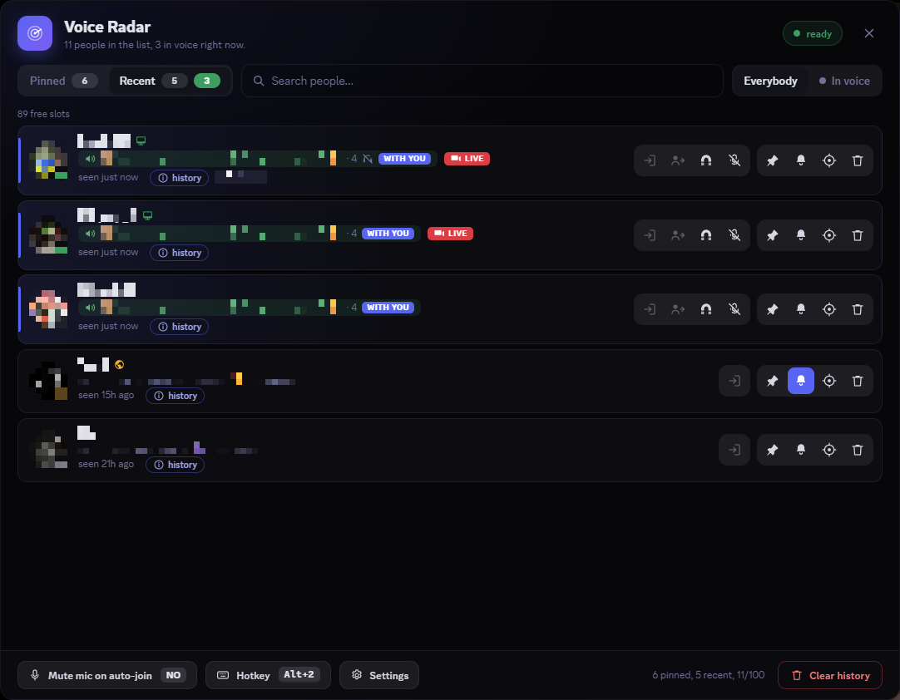
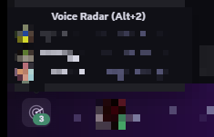
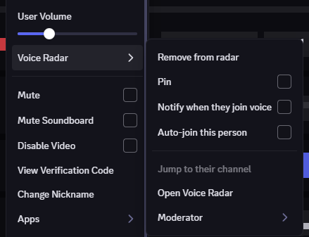
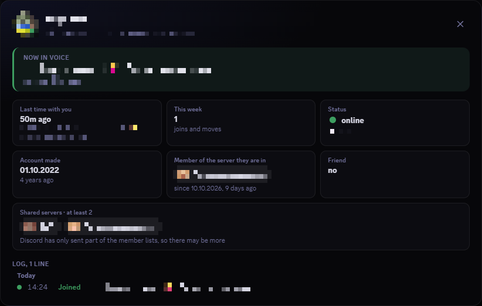

# VoiceRadar-Discord

Vencord plugin. Remembers everyone you shared a voice channel with and shows where they are now.

## Features

- **List.** Everyone you met in voice, newest first, up to the limit (15 by default). Anything you
  switched on by hand keeps its slot: a pin, a bell, the auto-join target, the magnet, and people you
  added yourself.
- **Two tabs.** Pinned and Recent, each with its own count plus a green one for who is in voice right
  now. Pinned rows drag into any order.
- **Per row.** Channel, server, headcount, status, activity chip, mic, headphones, camera, when you
  last sat together, when they left voice, and one icon per device the person is online from. Times
  are exact, such as "left at 19:35", never rounded to "6 min ago". A right click opens Discord's own
  menu for that person.
- **Join.** A button on every row and in the right-click menu. Padlock on channels you cannot enter,
  a queue on full ones, and hidden channels still name their members on hover.
- **Mute mic on auto-join** (off by default). Joins the plugin makes start with your mic off.
- **Auto-join.** Pick one person and you follow them, with no other switch to turn on. The target sits
  on its own card at the top of the window, with a button to stop. You follow them into a full
  channel once a slot opens, and the wait moves with them. Walking out of their channel, or out of
  voice altogether, leaves that channel alone until they move somewhere else. Somebody else
  disconnecting you or moving you out is undone instead, up to six times a minute.
- **Queue.** Holds your place in a full channel until you get in or cancel.
- **Info.** A button under each name, and an entry in the right-click menu, opens what is known
  about the person. The log is grouped into stays, one block per channel they sat in, and what
  happened during a stay sits inside its block: their stream and camera going on and off, and your
  own joins and leaves with how long you sat together. When Discord comes up, whoever already sits
  in voice gets a line, and so does whoever left while it was closed. Every time shown is exact.
  Where only a range is known, such as a leave while Discord was closed or an event Discord sent
  late after a dropped connection, the line shows a question mark and the two moments it surely
  fell between. Time together is only counted over stretches the plugin watched without a break,
  and a dashed rail marks where it was not watching. The newest stay is on top and arrows show the
  order: a line runs from the row that brought the person in up to the channel's name, another from
  the name to the row that took them out, and an arrow leads from block to block when they moved. A
  dashed one says how long they were not seen in voice, when the plugin watched all of that time.
  Hovering a line shows who sat in that channel at that moment and who sits there now,
  and the card on top shows everybody in their current channel. A left click on any of those people
  opens their profile, a right click Discord's menu for them. The tiles say when you were last seen together, the joins and moves of the last seven
  days the plugin saw, and the account's age in whole years and months. A button in
  its header opens the person on a lookup site, discord-sensor.com unless you set another, in a
  window of its own inside Discord. You sign in to the site there once and it remembers you. The
  plugin reads nothing from the site, it only shows the page when you click.
  <sub>The log keeps the last 200 entries per person, only on your computer, opens on its newest three days and says how full it is.</sub>
- **Mod View.** A double button on the row, in the info window and in the right-click menu opens
  Discord's own Mod View panel for the person. The shield half picks the server they sit on, the
  arrow half lists your other shared servers. Discord keeps that panel for moderators, so the plugin
  lifts the check the way Vencord's ShowHiddenThings does, only for the panels it opens itself, and
  it works on any shared server with no rights at all.
- **Notifications.** A bell per person, naming the channel. Several joins collapse into one. A card
  in the corner of Discord shows who joined, with a Join button, and waits until you look at Discord,
  since Windows hides its own notification during a game. A sound goes with it, the plugin chime
  or a file of your own, and a button in the settings shows how it all looks.
- **Stream preview.** `LIVE` badge, thumbnail on hover, full size on click.
- **Search.** Nickname, display name or username, and a switch between everybody and only whoever
  is in voice this second. Typing anywhere in the window goes into the search, and the first `Esc`
  empties it. The button beside the box widens the search to everybody in voice on the watched
  servers, people outside the radar included, each with a join and an add button.
- **Hotkey.** `Alt+2` opens and closes the window. Rebindable, and claimable system wide.
- **Windows.** The radar, the history, the join list and the health page are drawn on their own
  rather than as Discord modals, which is what lets them open without a stall. A row's buttons sit in
  two strips, voice first and the list second, and whatever Discord opens from a window still comes
  up on top of it. Drag a window by its title to move it and by any edge or corner to resize it, and
  it opens there next time. A double click on the title puts it back in the middle. A button in the
  radar's title pops it out into a window of its own, the same kind Discord uses for its popouts, which
  goes anywhere, another monitor included, can stay above other windows, and leaves Discord free to use.
  Right-click menus, the plugin's windows, questions and messages open in that window too, while
  anything of Discord's own a click there opens, such as a profile, a chat, Mod View or the settings,
  comes up in Discord and brings it forward.
- **Startup.** Servers are asked for voice states ten at a time, so the radar is ready a few seconds
  after Discord logs in.
- **Moderator mode** (on by default, shows nothing where you lack the rights). Pull one person or a whole channel to you (99 per click,
  confirmation past eight, four moves at a time by default), undo a pull, magnet one person back each
  time they leave, or move your whole channel to another one, everybody first and you last, from the
  menu of that channel or of somebody sitting in it. Moves need Move Members in both channels of the
  same server. The magnet shows wherever you may move the person and waits while you sit somewhere it
  cannot pull them to.
- **UI.** Account panel button with a counter, submenu in user menus and in the three dots of a profile, entry in voice and
  stage channel menus.
- **Languages.** English and Russian, following Discord by default.

## Install

Needs a [Vencord dev install](https://docs.vencord.dev/installing/). From the root of that checkout:

```bash
git clone https://github.com/MrTopQ/VoiceRadar-Discord src/userplugins/VoiceRadar-Discord
```

```bash
pnpm build && pnpm inject
```

`pnpm inject` only the first time. Restart Discord, then enable **VoiceRadar-Discord** in Vencord
settings, Plugins. Without git, download the ZIP into `src/userplugins/` by hand.

## Settings

Eighteen, in panel order. Vencord prints a longer description beside each.

| Setting | Control | Default | What it does |
|---|---|---|---|
| Language | dropdown | Auto | Auto (follow Discord), English, Русский |
| People the list keeps | slider, 5 to 200 | 15 | Pinned people take slots too |
| Hotkey | text | `Alt+2` | Opens and closes the window |
| Mute mic on auto-join | switch | off | Mutes your mic on every join the plugin makes |
| Only follow when idle | switch | off | Never pulls you out of a call |
| Auto-join cooldown | seconds | 0 | Gap between two auto-joins, 0 to 5min, 0 follows at once |
| Join alert | dropdown | With the plugin chime | A card in Discord plus a Windows notification while Discord is in the background, with the plugin chime or your own sound, or off |
| Your own sound | file | none | Shown for the own-sound choice. mp3, ogg, wav or m4a up to 2 MB, cut at 5 seconds |
| Join sound volume | slider, 0 to 100 | 60 | How loud that sound is |
| Test | button | | Shows the card and plays the sound, as if somebody joined |
| Highlight joins and leaves | slider, 1 to 5 min | 1 | How long a row stays marked after the person joined or left your voice channel |
| Queue for full channels | switch | on | Auto-join only. Queueing by hand works either way |
| Track automatically | switch | on | Remembers everyone you share a voice channel with |
| Servers watched for voice | slider, 10 to 200 | 100 | Discord only sends voice states for subscribed servers, so joins past this number go unseen. Your people's servers come first, and the window says how many did not fit |
| Keep timers awake | switch | on | Holds Discord's timers at normal pace in the background, so a join reaches you in seconds instead of minutes |
| Group move speed | dropdown | Fast | Careful sends one move at a time, Fast four, Instant eight. Every move is a line in the server's audit log |
| Moderator mode | switch | on | Adds pull, undo and magnet where you hold the permission |
| Lookup site | text | discord-sensor.com/members/{id} | The info window's button, {id} becomes the person's ID, empty removes it |
| Panel button | switch | on | Goes away at once, needs a restart to come back |
| Hotkey system wide | switch | off | The hotkey fires while Discord sits in the background and brings it up. Needs a full restart |

## Notes

- The list stays on your machine, in IndexedDB through Vencord's DataStore. The plugin talks to
  Discord and to nothing else.
- One auto-join target or one magnet at a time. Arming either disarms the other and drops your queue.
- Requests go through the client's own REST and gateway paths, spaced out: names 250ms apart,
  statuses in one batch of up to 100 people, one server subscription every 1.2s, and group moves at
  the pace you pick. A rate limit waits itself out once, and the magnet stops after ten returns in a
  minute.
- The status chip opens a page listing every feature, the Discord internals behind it and whether
  they still sit where the plugin expects, plus how much of Discord's voice picture the client holds.
- The panel button coexists with other plugins that add buttons there.

## License

GPL-3.0. See [LICENSE](LICENSE).

## Screenshots








